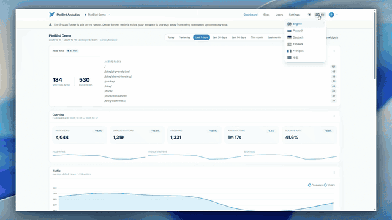

# PlotBird Analytics

**Self-hosted, cookie-free web analytics in plain PHP.** No Docker, no Node on
the server, no SSH, no Composer — upload the folder to a classic shared hosting,
install it in the browser, paste one `<script>` tag into your website.

[](https://github.com/plotbird/analytics/actions/workflows/tests.yml)
[](LICENSE)
[](https://www.php.net)

[Русская версия](README.ru.md)

<p align="center">
  
</p>

---

## Quick start

1. Upload the release archive to your hosting and open the site in a browser.
2. The installer creates the tables, the administrator and your first website.
3. Paste the one-line tracker into your pages and delete `install/`.

Full details are in [Installation](#installation). Requirements are PHP 8.0+ and
MySQL 5.7+ or MariaDB 10.3+, nothing else.

## Why PlotBird

Most self-hosted analytics ask for a VPS: Plausible needs Elixir and
ClickHouse, Umami needs Node, GoatCounter wants a binary you deploy yourself.
**PlotBird is aimed at the millions of sites that live on €3 shared hosting**,
where the only things you have are PHP, MySQL, FTP and a control panel.

* **Installs entirely in the browser.** No SSH, no `php bin/console`, no
  Composer. The seven-step wizard checks the environment, creates the tables,
  writes the configuration, creates the administrator and adds your first
  website. That is the whole reason this project exists.
* **Real geolocation, still out of the box.** A DB-IP Lite country base ships
  with the project and is imported into MySQL during installation, so country
  reports work on day one with no external API, no license key and no download.
  (Reading the country from the browser's language, as some tools do, tells you
  where the visitor's *browser* is configured, not where they are.)
* **No cookies at all.** Visitors are counted with a salted, daily
  `md5(IP + User-Agent + salt + date)` pseudonym. Nothing is stored in the
  browser and nothing follows anybody across the web.
* **Featherweight.** The tracker is **1.3 KB**, and the dashboard ships 43 KB of
  pre-compiled CSS instead of a runtime CSS compiler. All front-end libraries
  are vendored locally: the dashboard also works on a server without internet
  access.
* **Upgradable by FTP.** Schema changes ship as plain SQL migrations and are
  applied from the settings page — no shell, no manual `ALTER TABLE`.

## Features

| | |
|---|---|
| **Dashboard** | Drag & drop widget grid, hide/show widgets, layout remembered per website, instant switching between websites and periods over AJAX |
| **Widgets** | Real-time counter (5 min), overview cards with previous-period comparison, traffic chart (by day or the hour), top pages, traffic sources & entry pages, countries + interactive world map, devices/OS/browsers |
| **Visitor log** | One row per session: start time in the website's time zone, duration, page count, entry and exit page, source, country, device — click a row to see every page of that session. The visitor's IP address can be shown too (opt-in, see below) |
| **Tracking** | `<2 KB` tracker, `sendBeacon` with `fetch` fallback, SPA route changes, bot filtering, per-site include/exclude rules, rate limiting, allowed-host list |
| **Goals** | Conversions measured two ways: reaching a page (no site changes needed) or a named event from `plotbird.track('signup')`. Conversions, unique converting visitors, conversion rate and the change against the previous period |
| **Accounts** | Super administrator (everything) and clients (only the websites assigned to them, switchable in the header) |
| **Sharing** | Public read-only dashboards via `/share/<token>` links with optional expiry and one-click revocation; only a SHA-256 hash of the token is stored, and the visitor log is never exposed there |
| **PWA** | Installable on a phone or desktop, works as a standalone app |
| **i18n** | English, Русский, Deutsch, Español, Français, 中文 — browser-language detection and a switcher everywhere |
| **Privacy** | No cookies, IP anonymisation, optional Do-Not-Track support, configurable retention, country-only geolocation by default |
| **Security** | PDO prepared statements only, CSRF tokens on every form, `password_hash()`, session fingerprinting, brute-force lockout, protected `config/`, locked installer, audit log |
| **Maintenance** | Cron endpoint, schema migrations from the UI, retention pruning, GeoIP updater, IP-database import from the browser |

## How it compares

Different tools, different trade-offs. All of them are good at what they are
built for; this table is about the deployment model.

| | PlotBird | Matomo | Plausible | Umami | GoatCounter |
|---|---|---|---|---|---|
| Stack | PHP + MySQL | PHP + MySQL | Elixir + ClickHouse | Node + PostgreSQL/MySQL | Go |
| Runs on shared hosting without SSH | **yes** | yes | no | no | rarely |
| Installer in the browser | **yes** | yes | no | no | no |
| Cookies by default | **no** | yes | no | no | no |
| Country from a local IP database | **bundled** | plugin | bundled (MaxMind) | bundled | no |
| Schema upgrades without a shell | **yes (UI)** | yes | no | no | no |
| Tracker size | **1.3 KB** | ~20 KB | ~1 KB | ~2 KB | ~3 KB |
| Feature depth | small | huge | medium | large | small |
| License | AGPL-3.0 | GPL-3.0 | AGPL-3.0 | MIT | own |

If you need goals, funnels, e-commerce tracking or a plugin ecosystem today,
Matomo is the safer choice. PlotBird deliberately stays small and cheap to run.

## Requirements

* PHP **8.0+** with `pdo_mysql`, `mbstring`, `json` (plus `zlib` for the bundled
  IP database, and `curl` or `allow_url_fopen` if you want to download newer
  ones)
* MySQL **5.7+** or MariaDB **10.2+** — no special configuration, no timezone
  tables needed
* Apache with `mod_rewrite` (an `.htaccess` is included) or nginx (see below)
* Roughly 40 MB of disk space

## Installation

1. Upload the whole folder to your hosting (document root or a sub-directory —
   both work) and point the domain at it.
2. Make sure `config/` and `data/` are writable (usually `755` is enough).
3. Open the site. You are redirected to `/install/` and walked through seven
   steps: language → requirements → database → tables + `config.php` →
   administrator → first website + tracking code → finish.
4. **Delete the `/install/` folder.** The wizard locks itself as soon as an
   administrator exists, but deleting the folder removes the risk entirely.
5. Point a cron job at the URL shown on the settings page (see below).

### Cron (recommended)

```
https://your-domain.example/api/cron.php?secret=<generated secret>
```

Every five minutes: refresh the daily rollups, prune raw hits past the retention
window, keep the IP database current. Without cron PlotBird still works —
rollups are then computed lazily, and the first dashboard load of the day is a
little slower.

### Tracking code

```html
<script async defer src="https://your-domain.example/assets/tracker.js"
        data-website-id="00000000-0000-0000-0000-000000000000"></script>
```

Paste it into the `<head>` of every page you want to measure. The installer and
the Websites page can verify that hits are arriving.

### nginx

`nginx` ignores `.htaccess`, so translate it once:

```nginx
server {
    root /var/www/plotbird;
    index index.php;

    location / {
        try_files $uri $uri/ /index.php?$query_string;
    }

    location ~ ^/(config|core|data|locales|templates|tests|migrations)/ {
        deny all;
        return 404;
    }

    location ~ \.php$ {
        include fastcgi_params;
        fastcgi_pass unix:/run/php/php8.2-fpm.sock;
        fastcgi_param SCRIPT_FILENAME $document_root$fastcgi_script_name;
    }

    location ~* ^/assets/.*\.(css|js|svg|png|woff2)$ {
        expires 30d;
        add_header Cache-Control "public";
    }
}
```

## Goals and events

A goal answers the only question that matters commercially: **how many visitors
did what the site exists for?**

Two kinds, added per website on the *Websites* page:

* **Page goal** — a visitor reached a path, e.g. `/thanks`, `/checkout/success`,
  or `/checkout/*` for everything under a prefix. Counted from ordinary page
  views: no change to the website is needed.
* **Event goal** — the page called the tracker:

  ```js
  plotbird.track('signup');
  ```

  Event names may contain letters, digits, dots, dashes, colons and underscores.
  The tracker exposes the API as soon as it loads; if you need to fire an event
  earlier than that, queue it first:

  ```js
  window.plotbird = window.plotbird || { q: [] };
  window.plotbird.track = function (name) { plotbird.q.push(name); };
  ```

  The queue is flushed when the tracker starts.

The dashboard then shows, per goal: unique visitors who converted, the
conversion rate against all visitors of the period, the number of converting
visits and the change against the previous period. Events are stored separately
from page views, so tracking an event never inflates your page or session
counts.

Deleting a goal deletes its statistics too; disabling it keeps the history and
simply hides it from the dashboard. What a goal points at cannot be edited —
rename it or add a new one, otherwise past conversions would silently be
reinterpreted.

## Updating

PlotBird is designed to be updated the same way it is installed: over FTP.

1. Upload the new files over the old ones, **keeping** `config/config.php` and
   the `data/` directory.
2. Open the dashboard. If the release contains a database change, a banner says
   so; press **Update now** (or use *Settings → Database schema*). The SQL
   migrations run in order and are recorded, so a failed step can be retried
   safely.
3. Reload the page. Asset URLs carry a modification-time hash, so browsers pick
   up the new JavaScript and CSS without a hard refresh.

## Troubleshooting

* **Every visit is attributed to the same country, or to `ZZ`.** The client
  address is being replaced by the proxy, CDN or load balancer in front of the
  site, so every hit looks like it comes from one machine. Name the proxy in
  `security.trusted_proxies` in `config/config.php` - a single address
  (`'203.0.113.7'`), a network (`'10.0.0.0/8'`) or `true` when the application is
  not reachable directly at all. The header is only trusted from that list.

  On a host with opcache, an edited `config.php` can keep serving the old copy
  until the cache revalidates. Restart PHP or wait a few seconds before
  concluding that the change did nothing.

* **The installer is still reachable.** The wizard locks itself once an
  administrator exists, but delete the `install/` folder anyway.

* **Nothing is recorded.** Open the website's code panel on the Websites page and
  press "Check the code": it says whether a hit has arrived. A site with hits
  blocked will show `blocked` in the visitor log - file-based rate limiting, bot
  filtering and the path rules are the usual suspects, and each one is listed in
  the settings.

## Visitor IP addresses (opt-in)

By default no IP address is ever written to the database: only a salted daily
hash, and the network part is truncated before hashing (IPv4 `/24`, IPv6 `/48`).

If you need to identify individual sessions — for support, abuse investigation
or log correlation — enable **Settings → Store visitor IP addresses**. The
visitor log then shows the address of every session. Read the warning that comes
with it: IP addresses are personal data, so you need a legal basis, a privacy
policy that mentions the processing, and preferably a shorter retention window.
Every toggle of that switch is written to the activity log so you can show when
it was on.

## Compliance notes

PlotBird is built so that a consent banner is usually not needed — but that is a
legal assessment for **you as the operator**, not a property of the software.

What the software does: no cookies and no `localStorage` on the visitor's side,
no cross-site identifier, no fingerprinting, country-level geolocation by
default, Do-Not-Track support, and configurable deletion of raw hits.

Two caveats worth knowing before you rely on it:

1. **The French DPA (CNIL)** grants a consent exemption for audience
   measurement only under conditions: first-party purpose, anonymous output, no
   transfer of non-anonymous data to third parties, and no cross-site tracking
   through a shared identifier. It also recommends informing users, limiting the
   identifier lifetime (13 months) and keeping data for **at most 25 months**.
   There is an official self-assessment questionnaire for solution providers:
   [Cookies : solutions pour les outils de mesure d'audience](https://www.cnil.fr/fr/cookies-solutions-pour-les-outils-de-mesure-daudience).
   The CNIL explicitly forbids describing a tool as "certified" or "approved" by
   it. Keep `retention_days` at 760 or below if you want to stay inside those
   recommendations.
2. **Cookie-less is not "no personal data".** An IP address is personal data
   under the GDPR. You remain the controller: mention the analytics in your
   privacy policy and keep the legal basis on file.

## How the numbers are defined

* **Visitor** — a unique daily pseudonym: `md5(IP + User-Agent + salt + date)`.
  The same person tomorrow is a new visitor; that is the price of not using
  cookies.
* **Visit (session)** — consecutive page views closer together than the visit
  timeout (30 minutes by default).
* **Bounce** — a visit with exactly one page view.
* **Visit duration** — last page view minus first page view.
* **Range visitors** — the sum of the daily unique counts, because a distinct
  cross-day count is impossible without an identifier that survives the day.
* **Conversion** — a visit that reached a goal page, or that fired a matching
  event. A visitor who reaches the goal page twice in one session converts once.
* **Conversion rate** — the unique visitors who converted divided by all unique
  visitors of the period.
* **Time zone** — each website is bucketed in its own time zone; the dashboard
  and the visitor log both say which one.

## Security

See [SECURITY.md](SECURITY.md) for how to report a vulnerability and for a
hardening checklist. The short version: delete `/install/`, keep `config/`
unreachable over HTTP, serve the site over HTTPS, and set a long random
`cron_secret`.

The project is young and has not had an independent security audit. If that
matters for your use case, read the code — it is about 40 small files.

## Development

```bash
# Serve the project locally (mirrors the shipped .htaccess routing)
php -S 127.0.0.1:8080 tests/router.php

# Run the end-to-end suite: installs, tracks hits, checks every page
php tests/e2e.php
php tests/e2e.php --with-geoip   # also imports the full IP database
```

The suite starts PHP's built-in server, installs the application through the
real installer, and asserts 223 behaviours across the installer, the tracker,
the API, the dashboard and the access rules. CI runs it on PHP 8.0–8.4 against
MySQL 8.0 and MariaDB 11.4.

The dashboard styles are compiled ahead of time — `npm` is only needed for that:

```bash
npm install && npm run build:css
```

## Licence

**PlotBird Analytics is free software under the GNU Affero General Public
License, version 3 or later** — see [LICENSE](LICENSE). Copyright © the PlotBird
Analytics contributors.

You can self-host it, modify it and redistribute it freely. The one thing the
AGPL asks is that if you offer it to third parties as a network service, you
also offer them the source of the version you run — including your changes.

If you need to run it as a **closed** hosted service or embed it in a
proprietary product, a **commercial licence** is available; that removes the
source-disclosure obligation. [LICENSING.md](LICENSING.md) explains the details.

The name and the logo are not covered by the code licence: forks are welcome,
but a fork must be renamed and must not present itself as the upstream project.

Bundled data and libraries keep their own licences and are listed in
[THIRD-PARTY-NOTICES.md](THIRD-PARTY-NOTICES.md). In short:

* **DB-IP Lite** country database, © DB-IP — [CC BY 4.0](https://creativecommons.org/licenses/by/4.0/).
  Bundled in `data/geoip/` so a fresh install geolocates without downloading
  anything; the attribution is shown on the settings page. Delete the file and
  the attribution with it if you do not want them.
* Flags: [flag-icons](https://github.com/lipis/flag-icons) (MIT).
* Country names: [i18n-iso-countries](https://github.com/michaelwittig/node-i18n-iso-countries) (MIT).
* Front-end: [Tailwind CSS](https://tailwindcss.com) (MIT),
  [Alpine.js](https://alpinejs.dev) (MIT),
  [Chart.js](https://www.chartjs.org) (MIT),
  [jsVectorMap](https://jvm-docs.vercel.app) (MIT),
  [Sortable](https://sortablejs.github.io/Sortable/) (MIT),
  [Inter](https://rsms.me/inter/) (OFL).
